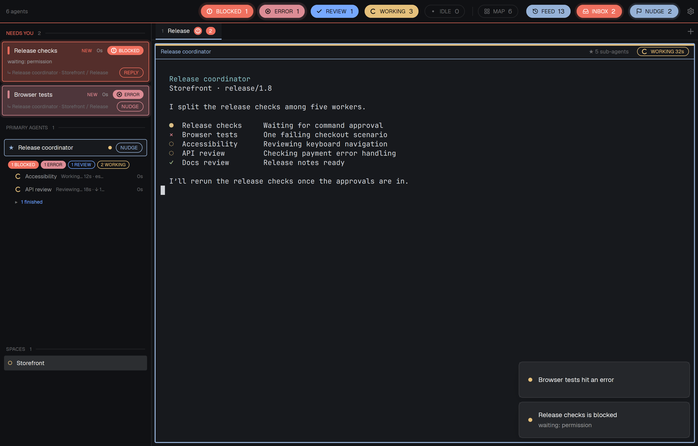
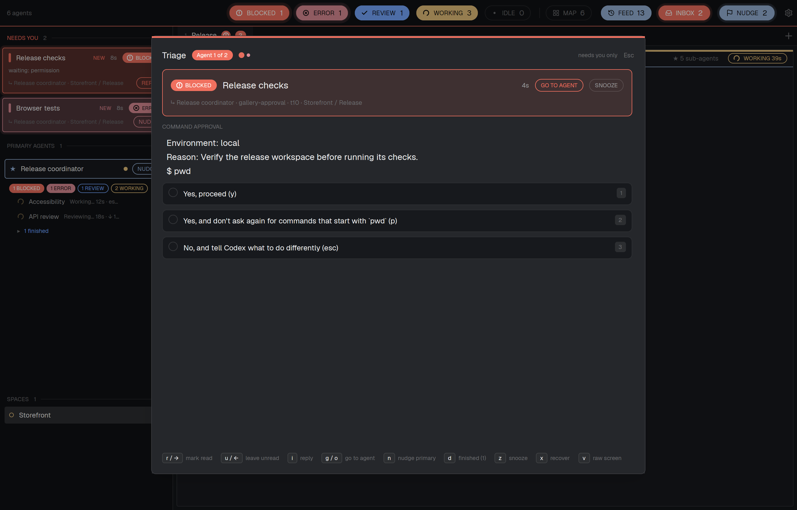

# Conduct: a Herdr layout for running many agents from one primary agent

Built for the workflow where you talk to a primary agent that starts dozens of sub-agents with `hc run`. The window answers *which agent needs me, and what does it need?* Blocked, error, and stuck chips pulse when there are agents to review. Working and finished counts stay visible beside them. A hotkey inbox walks you through each waiting agent and its questions, then on to the next. See [RECIPE.md](RECIPE.md) for exactly what it looks like and does.




**Using another harness (Codex, Gemini CLI, Aider, ...)?** [HARNESSES.md](HARNESSES.md) says what works out of the box, what each harness needs, and how an agent can add it for you.

## Install

```sh
git clone https://github.com/sneakytowelsuit/dotfiles
cd dotfiles/herdr-conduct
H=~/.config/herdr-app
cp layouts/conduct.json "$H/layouts/"
cp -r mods/conduct-* "$H/mods/"
# merge the "layout:conduct" section of keys.json into $H/keys.json (the settings mod edits it from then on)
herdr-app do layout.switch --name conduct
```

Or tell your agent to add the layout from `sneakytowelsuit/dotfiles`, folder `herdr-conduct`. Don't overwrite files you already have. Then `herdr-app check ~/.config/herdr-app/mods/conduct-bar` (and the other `conduct-*` mods) should pass. `ctrl-shift-l` switches layouts; deleting the files removes it. Themes need no copying: the settings mod writes the theme files it needs.

## What it does

- **Top bar:** a chip per state with its count, aligned toward the right (compact dots and counts when there is no room). Counts above zero use the state colour; `BLOCKED`, `ERROR`, and `STUCK?` also get a pulsing halo. Click a chip to jump to the next agent in that state, press and hold for a menu of them. `INBOX n`, `⚑ NUDGE` and a gear for settings sit on the right; the chips scroll sideways rather than being cut off.
- **Tab row:** over the work area (beside the sidebar), the shown space's tabs with a dot for the most urgent state of the agents in each (and a count of those that need you), plus a `+` for a new tab. Click selects, right-click opens the tab menu.
- **Sidebar:** `NEEDS YOU` (a card per agent that needs a decision, with `REPLY` / `NUDGE`), a card per primary agent (state counts, working sub-agents with their live activity such as `Thingamajigging… 12s · ↓ 1.2k tokens`, `▸ n finished`, `▸ n idle`), other agents, and spaces.
- **Pane headers:** a status stripe and a state pill with how long; only critical states fill and pulse.
- **Stuck detection:** an agent that says it is working but whose screen has not changed for 3 minutes shows as `STUCK?` and counts as needing you.
- **Nudge:** `⚑ NUDGE` (or the button on a primary's card) composes a message telling the primary that the IDs are Herdr terminal addresses (not session names), naming the `hc` commands to use, and listing the sub-agents that need attention. You edit it, then send.
- **Inbox** (`alt-t`): one waiting agent at a time, with `Agent i of n`, then its card:
  - **Claude Code questions** are drawn as a real form (radio or checkboxes, descriptions, `Something else…`, preview layouts with notes, `Skip`, `Reset`, `Back`, a review step) and answered by pressing the keys the terminal menu expects. `QUESTION k OF n` chips jump between questions. `Submit and go to next agent` sends and advances by itself.
  - **Codex command approvals** show the command and its choices. Select a choice by click or number, then confirm. Conduct checks the active prompt before sending the key.
  - Recognized text prompts get quick replies and a multi-line reply box (`Ctrl+Enter` sends). Other prompts show the screen and let you jump to the terminal.
  - `r` marks read, `u` leaves it unread, `g` goes to the agent's terminal, `d` opens the **Finished** list (information only: finished agents and what they last said), `v` shows the raw screen. Every hint chip is clickable.
- **Settings** (gear, `alt-,`): every hotkey is editable (global keys go into `keys.json`, inbox keys are stored by the layout) with conflict warnings and one-click presets that move all global keys to `ctrl-alt`, `ctrl-shift` or `cmd-shift` (for tiling window managers such as Aerospace that own `alt-…`); and 18 colour themes: Catppuccin (4), Nord, Gruvbox (2), Rosé Pine (3), Dracula, Tokyo Night (2), Solarized (2), Everforest, Kanagawa, GitHub Dark.

Default hotkeys: global `alt-t` inbox, `alt-n` / `alt-p` next / previous agent needing you, `alt-m` nudge, `alt-,` settings. Inbox keys are listed in settings.

## More tools

- **State glyphs:** every state has a shape as well as a colour (`!` blocked, `✕` error, pause bars stuck, check finished, an arc working, a dot idle), in the bar, sidebar, tabs, pane headers and the inbox.
- **Agent map** (`alt-a`): the whole fleet as a grid of cells grouped by primary, filled only for blocked and error; hover for details, click or Enter to go there, legend chips filter by state. Scales to about 100 agents.
- **Activity feed** (`ctrl-alt-f`, the `FEED n` pill): a timeline of what happened while you were away (blocked, errors, finishes, arrivals), with a "since you last looked" divider. **Alerts** (`ctrl-alt-a`): toast, sound and optional phone push (ntfy, off by default) for newly blocked, errored or stuck agents; quiet hours; batches a burst into one alert.
- **Snooze** (`z` in the inbox, or `SNOOZE`): hide an agent for 5 minutes to tomorrow morning; it returns when the time ends or its state changes. "Tell me when this finishes" watches an agent. A `SNOOZED n` chip shows how many are hidden.
- **Recover** (`x`, or `RECOVER` on stuck and errored cards): ask for a status, interrupt then ask, restart, restart and resume (Claude Code with `--continue`, or plain interactive Codex with `resume --last`), end it; destructive ones need a second click. Optional auto-nudge sends one status check to an agent that has been stuck for N minutes.
- **Usage** (`ctrl-alt-u`, the `$/hr` pill): for Claude Code agents, a context-window bar, a prompt-cache timer (warm, cooling, cold), a hit-ratio sparkline, session and last-turn cost, cache savings and burn rate, in the sidebar rows, the pane header and a Usage dialog. Local Codex agents with an open rollout show context and cache-hit share. Their cost and cache-expiry fields are blank. The rollout supplies token counts, and Conduct currently has no Codex pricing adapter. Claude Code costs are estimates from a dated price table (`PRICES` in `usage.js`).
- **Batch reply** (`ctrl-alt-b`): answer several blocked agents with recognized text prompts at once; agents waiting on the same message are grouped, you tick who gets the reply, and a confirm step shows exactly who will receive it.
- **Jump palette** (`ctrl-alt-k`) and **previous agent** (`ctrl-alt-tab`): fuzzy-find any agent, space or tab; jump back to the agent you came from.
- **Density** (Settings, Density tab): comfortable or compact sidebar rows for big fleets.
- **Other harnesses:** see [HARNESSES.md](HARNESSES.md).

Hotkeys listed here are the defaults; all are editable in Settings.

## What it touches

- It runs `hc read`, `hc keys`, `hc send` and `hc interrupt` on agent terminals: it reads their screens (for activity lines, stuck detection and question forms) and types into them only when you click or press a key. Nothing is sent over the network.
- The settings mod writes `~/.config/herdr-app/keys.json` (section `layout:conduct`), `settings.json` (`appearance`, only when you pick a theme) and `themes/*.json`.
- Forms depend on the harness's terminal menu. Conduct recognizes Claude Code question forms and Codex command approvals.
- **Usage** reads only token counts, model names and timestamps from local Claude Code transcripts and Codex rollouts using `tail` and `jq`; without `jq` no usage is shown.
- **Alerts:** local by default. If you turn on phone push, each alert sends the agent's title and one-line message to ntfy.sh (a third-party server) over HTTPS with `curl`; the topic name acts as a password.
- **Recover** can kill and restart terminals, only when you confirm.

## Editing

Run `./sync-shared.sh` after editing a shared module or the harness registry in `mods/conduct-harnesses/`. Herdr resolves imports within each mod folder, so CI checks the generated copies. Themes are generated by `python3 themes/generate.py` (it also rewrites `mods/conduct-settings/themes.js`).

## Testing without spending tokens

`test/scenario.sh up [n]` starts `n` fake agents (`test/fake-agent.sh`) as sub-agents of the terminal it runs in, reporting every state over OSC 7501 with a Claude-like activity line; `down` removes them. Run it from a terminal inside Herdr so that terminal becomes the primary. `test/haiku-question.sh [n]` starts real Haiku agents that stop on a blocking question (a few cents each), for the real blocked, reply, finished path.

## Limits

How long an agent has been in a state is counted from when this layout first saw it. Activity-line parsing is verified for Claude Code and Codex. Claude's own menu can't clear an answer already sent. `Record` in settings can't capture a key Herdr already binds: type it into the box.
