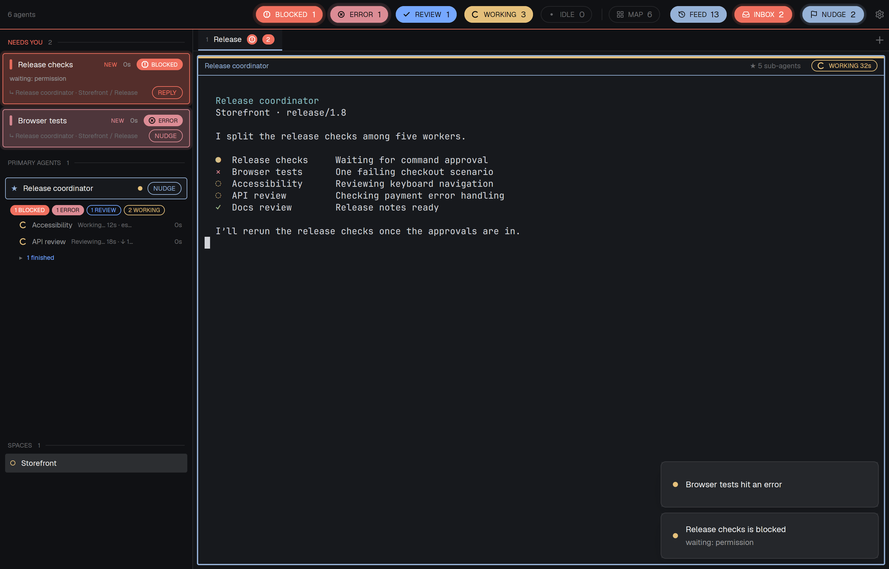
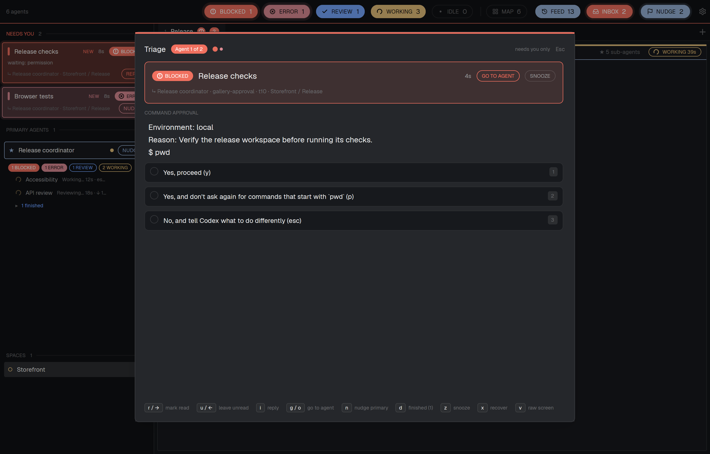

# Conduct

A Herdr window for running many agents from one primary agent. The top bar and sidebar answer one question: *which agent needs me, and what does it need?* States that need a decision (blocked, error, stuck) are filled chips with a pulsing halo; states that don't (working, finished, idle) are quiet outlines. A hotkey inbox walks you through each waiting agent and its questions, a Finished list holds the information-only completions, a NUDGE button asks the primary to check on its sub-agents, and a settings dialog changes every hotkey and the colour theme.

## What you see

A `column` on the theme's `canvas` colour, system title bar hidden, 14px terminals, UI in the app font:

- **Top bar, 46px** (drag to move the window; 1px bottom border that turns the "blocked" colour while anything is blocked, error or stuck). Left to right: the total agent count (11px, dim) at the left edge; one count chip per state, centred on the window, `BLOCKED`, `REVIEW`, `WORKING`, `IDLE` always, `ERROR` and `STUCK?` only when above zero (26px tall pills: 11px semibold label, 13px count); the right-hand group: an `INBOX n` pill; a `⚑ NUDGE` pill; a gear (settings) icon button; window buttons where the system draws none. The chips are centred on the window; when the window is too narrow or the zoom too high for them beside the buttons, they shrink to a colour dot plus the count (the name stays in the tooltip) and, past that, scroll sideways, so none is ever cut off.
  - `BLOCKED`, `ERROR`, `STUCK?` with a count above zero are **filled** in the state's colour with a **pulsing two-ring halo** (rings fade 0.15 to 1 and 1 to 0.2 over 1.3s). With zero, or for `REVIEW`, `WORKING`, `IDLE`, they are **outlines**: `REVIEW` is never filled or haloed.
  - `INBOX n` counts unread critical agents; filled and haloed in the colour of the most urgent one when n is above zero, a dim outline at zero. `NUDGE` is an accent-filled, haloed pill when a primary agent exists and something needs attention, plain otherwise.
  - Click a count chip: jump to the next agent in that state (repeat clicks cycle). Press and hold (450ms): a popup listing those agents; click one to go there.
- **Tab row, 34px** over the work area, to the right of the sidebar and under the bar (chrome background, 1px bottom border): the shown space's tabs, each `index  name` (an unnamed tab is called by its first agent's title; the index is dropped when it would repeat the name), 12px, the active one on the surface colour with a 2px accent underline. A dot shows the most urgent state of the agents in the tab (filled and pulsing for blocked, error, stuck; pulsing for working; outline for finished) and a small filled badge counts those that need you. Click selects, right-click opens Herdr's tab menu, the row scrolls sideways when full, and a `+` at the right starts a new tab.
- **Sidebar, 300px** (resizable 200 to 480), top to bottom in one scrolling column:
  1. `NEEDS YOU n`: one tinted, haloed card per blocked/error/stuck agent: a pulsing stripe, the agent's title (12px semibold), `NEW` until opened, time in that state, a filled state pill, the agent's own message (`waiting: question`) or its live activity line, `↳ primary · space / tab`, and a `REPLY` button (a question opens the inbox on that agent; otherwise a reply dialog) or `NUDGE`. Empty: "Nothing needs you."
  2. `PRIMARY AGENTS n`: a card per agent that has started sub-agents (★, title, status dot, `NUDGE`), a row of per-state count pills (outlines except blocked/error/stuck), working sub-agents as one line each (`worker-4  Thingamajigging… 12s · ↓ 1.2k tokens  3s`), `▸ n finished` and `▸ n idle` folds that expand to one-line rows.
  3. `OTHER AGENTS`: agents with no sub-agents and nothing to decide, one line each.
  4. `SPACES`: a row per space with its branch and a dot (a pulsing filled dot only while something in it is blocked).
- **Work area:** the shown tab's panes as cards (1px border, 3px radius, 6px gap, 2px accent border on the focused pane). Each pane has a 30px header: a 3px status stripe along the top edge (pulsing for critical states), the agent's title, `★ n sub-agents` for a primary, the git branch, and a state pill with how long (`BLOCKED 4m`), filled and pulsing only for critical states.
- **The inbox** (`alt-t`, the `INBOX` pill; a dialog at 62% x 86% of the window, so it survives zoom): a coloured 3px top strip, `Triage`, an `Agent i of n` pill and one dot per unread agent, then a scrolling body and a footer of clickable hotkey chips. The body shows one agent's card (state pill, title, `GO TO AGENT`, `↳ primary · name · address · space / tab`, its message) and then either:
  - **a question form** when the agent is showing a Claude Code question menu: `QUESTION k OF n` over clickable chips (one per question plus `Review`); the question in 15px semibold; radio rows (single select) or checkboxes (multi select) with descriptions and a number badge; `Something else…` for a typed answer; for a preview layout, the options on the left and the highlighted option's preview in a monospace box on the right with an optional notes field. Buttons: `Confirm` / `Continue` / `Skip this question →` / `Reset` / `← Back`; the last step is `Review your answers` with `Submit and go to next agent`, and unanswered questions listed as "not answered".
  - or **the tail of the agent's screen** with quick replies (`1 Yes, go ahead.` `2 No, don't do that.` `3 Continue.` `4 Skip that and move on.`), and a multi-line reply box with a `Send` button.
- **Finished list** (`d` in the inbox): one line per agent that finished unread: name, how long ago, its last message. Click opens the agent. Information only: nothing pulses.
- **Nudge dialog:** a multi-line message that tells the primary the IDs are Herdr terminal addresses and which `hc` commands to use, listing each flagged sub-agent; editable, `Ctrl+Enter` sends.
- **Settings dialog** (gear, `alt-,`): tabs `Hotkeys` and `Themes`.

## How it behaves

Agent statuses come from `terminals()` (herdr-core), which includes sub-agents started with `hc run`; `agents()` does not. A sub-agent has no pane: it is peeked (`terminal.peek`).

| State | Where it shows | Look | In the inbox |
|---|---|---|---|
| `blocked` | bar chip, NEEDS YOU, pane header | filled red, halo | yes |
| `error` | same | filled, halo | yes |
| `stalled` (`STUCK?`) | same | filled, halo | yes |
| `done` (`REVIEW`) | outline chip, `▸ n finished`, Finished list | outline | no (Finished list) |
| `working` | outline chip, one-line rows with the activity line | outline | no |
| `idle` | outline chip, `▸ n idle` | dim outline | no |

- **Stuck:** a `working` agent whose screen (ignoring the ticking clock) has not changed for 3 minutes (`conduct.stall_ms` overrides) is shown as `STUCK?`. The screen is read with `hc read` every 4s for working agents.
- **Activity line:** the last `✻ Verb… (stats)` line on a working agent's screen, shown as `Verb… stats`.
- **Time in state:** counted from when the layout first saw the state.
- **Read marks:** "read" records a state *and when it began*; the same agent blocking again later is unread again. A finished primary, or an agent you are looking at, is shown as idle. A `done` that follows your own answer or message is marked read automatically.
- **Inbox flow:** agents ordered by urgency, one primary's agents kept together. Answering a form (or `Submit and go to next agent`) sends the answers, shows "✓ Sent 2 answers to worker-3 → next: worker-4" and advances by itself. `r`/`u` on an agent with an unfinished form asks "Leave anyway?" first.
- **Question forms** are read off the agent's screen and driven by key presses (`hc keys`): a digit selects (single) or toggles (multi); `right` leaves a multi-select; `1` on the review step submits; `left` x n then `right` x k jumps to question k. Single-select clicks are staged (click again to clear) until `Confirm`; a digit sends at once. Typed answers are typed as keys when every character has a key, otherwise pasted with `hc send`.
- **Hotkeys** (defaults; all editable in settings): global `alt-t` inbox, `alt-n` / `alt-p` next / previous agent needing you, `alt-m` nudge, `alt-,` settings. In the inbox: `r`/`→` mark read, `u`/`←` leave unread, `i` reply, `g`/`o` go to agent, `n` nudge, `d` Finished list, `v` raw screen, `b` back, `s` skip, `Enter` confirm, `Esc`/`q`/`t` close, number keys pick options, `Ctrl+Enter` sends.
- **Zoom:** dialogs are a share of the window and scroll; only their header and footer are pinned.

## Built from

`layouts/conduct.json`, a `column` (`titlebar: none`, `font_size: 14`, `background: canvas`): `bar` (46px, `window_drag`, mod `conduct-bar`), then a `body` row (1px `border` divider) of `sidebar` (300px, min 200, max 480, mod `conduct-queue`) and a `work` column holding `tabs` (34px, mod `conduct-tabs`) above `main` (padding 6; `content: {tab: "active", pane: {gap 6, radius 3, background, border 1px, focus 2px accent, header: {mod conduct-pane, height 30, position top, reveal always}, lone: true}}`). No `theme` in the layout: it uses whichever theme the person picked.

Mods (each `mod.json` `{"place": "none"}`):

| Mod | Role |
|---|---|
| `conduct-bar` | top bar; also owns the `nextCommand` loop for `conduct-bar.next` / `.prev` / `.nudge`, and `gear.svg` and the window button icons |
| `conduct-queue` | sidebar; also the 4-second poller (activity lines, stuck detection, time in state, auto-read after answers) |
| `conduct-tabs` | the tab row (`plus.svg`); shows the shown space's tabs with their agents' states |
| `conduct-pane` | pane header |
| `conduct-menu` | the hold-a-chip popup |
| `conduct-send` | reply and nudge dialog (`props {mode: "agent" | "primary", address?}`) |
| `conduct-triage` | the inbox, question forms and Finished list (`overlay` 62% x 86%); `form.js` parses the question screens |
| `conduct-settings` | hotkeys and themes (`overlay` 62% x 86%); `themes.js` holds the 18 theme files |

Shared modules must be copied between mod folders (mods cannot import across folders); `sync-shared.sh` does it. `attn.js` (the model: agents, statuses, tree, read marks, `go`, `send`, `press`, halo) lives in `conduct-bar` and is copied to `conduct-queue`, `-tabs`, `-pane`, `-menu`, `-send`, `-triage`, `-settings`; `keys.js` (hotkey table and lookup) is copied to `conduct-triage` and `conduct-settings`.

`keys.json`: section `layout:conduct`: `alt-t` `mod.open:conduct-triage`, `alt-n` `conduct-bar.next`, `alt-p` `conduct-bar.prev`, `alt-m` `conduct-bar.nudge`, `alt-,` `mod.open:conduct-settings`. Merge it into the person's `keys.json`.

`herdr` API used: `agents`, `terminals`, `spaces`, `panes`, `theme`, `themes`, `settings`, `keys`, `window`, `run`, `hc`, `openOverlay`, `closeOverlay`, `props`, `shared`, `setShared`, `setAgentOrder`, `notify`, `nextCommand`, `readTextFile`, `writeTextFile`, `appHome`. Commands: `space.select`, `tab.select`, `tab.new`, `pane.focus`, `terminal.peek`, `mod.open`, `app.theme`, `window.minimize|maximize|close`. Motion is native (`.loop("opacity", ...)`); timers only for data (4s poll, 15s age refresh).

**Themes** (`themes/`, built by `themes/generate.py`, also embedded in `conduct-settings/themes.js` which writes missing ones to `~/.config/herdr-app/themes/`): Catppuccin (mocha, macchiato, frappe, latte), Nord, Gruvbox (dark, light), Rosé Pine (main, moon, dawn), Dracula, Tokyo Night (night, storm), Solarized (dark, light), Everforest, Kanagawa, GitHub Dark. Each is a full theme file (background, foreground, selection, cursor, 16 ANSI, panel `colors` incl. `working`, `blocked`, `done`, `idle`).

## Watch out

- **It runs programs and writes files outside its folders.** It runs `hc read` / `hc keys` / `hc send` / `hc interrupt` on agent terminals (reads their screens; types into them only when you click or press a key). The settings mod writes `~/.config/herdr-app/keys.json` (section `layout:conduct`), `settings.json` (`appearance`, when a theme is picked) and `themes/*.json`. No network.
- **`agents()` omits sub-agents.** Use `terminals()`; a sub-agent's `status` is an object (`report`), its `status_ms` is null, and its location is only a `where` label, so the layout inherits space and tab from its parent.
- **Never keep a click handler's `cx` across an `await`**: it goes stale. Use the context `init` received (an AsyncContext) for timers and `notify`.
- **`hc keys` cannot type** `! ? ( ) : _ " @ # $ % ^ & * ~ | { } < > +`; uppercase is `shift+letter`. Text with those characters, or a newline, is pasted with `hc send` (which presses Enter and tags the text `<hc from=…>`).
- **Claude Code question menus** (as of 2.1): digits select or toggle, they do not move the cursor in a preview layout; typing into the multi-select "Type something" row ticks it by itself and Enter would untick it; a notes box submits on Enter, so type notes, press `Esc`, then `Enter`; there is no way to clear an answer already sent. A different menu layout makes the form fall back to the raw screen.
- **Light themes only show in light appearance**, so picking one writes `appearance` to `settings.json`.
- **`app.theme` persists** and overrides the theme the layout would otherwise show.
- **Limits:** one question at a time is visible, so a form is read as you go; at most 24 unread dots; the Finished list reads at most 12 screens at a time.

## Done when

1. `herdr-app check mods/<name>` passes for all eight mods, `herdr-app status` shows no errors, and `layout.switch {name: "conduct"}` shows the bar, sidebar and panes.
2. With `test/scenario.sh up 12` (fake agents reporting every state over OSC 7501; run it from a terminal inside Herdr), the bar shows `BLOCKED 2`, `ERROR 1`, `REVIEW 1`, `WORKING 6`, `IDLE 3`; the first three are filled with a halo, the rest outlines; the sidebar lists the three needing agents under NEEDS YOU and a primary card with the rest.
3. After 3 minutes (or `conduct.stall_ms` lowered) a working agent whose screen does not change becomes `STUCK?`.
4. `alt-t` opens the inbox on the first blocked agent; `→` marks it read and shows the next; `←` skips; the count in `INBOX n` follows.
5. With a real Claude Code agent blocked on a question, the inbox draws it as a form; answering and submitting unblocks the agent, shows the "✓ Sent…" line and moves to the next agent; the agent's later "finished" is not left unread.
6. `d` opens the Finished list and `r` empties it; a finished agent never appears as an inbox card.
7. In settings, changing `alt-n` to another key updates `keys.json` and works at once, `Reset` restores it; clicking a theme recolours the window, and a light theme works on a dark system.
8. At zoom 1.8 nothing in the bar, sidebar or dialogs is cut off without a way to scroll to it.
