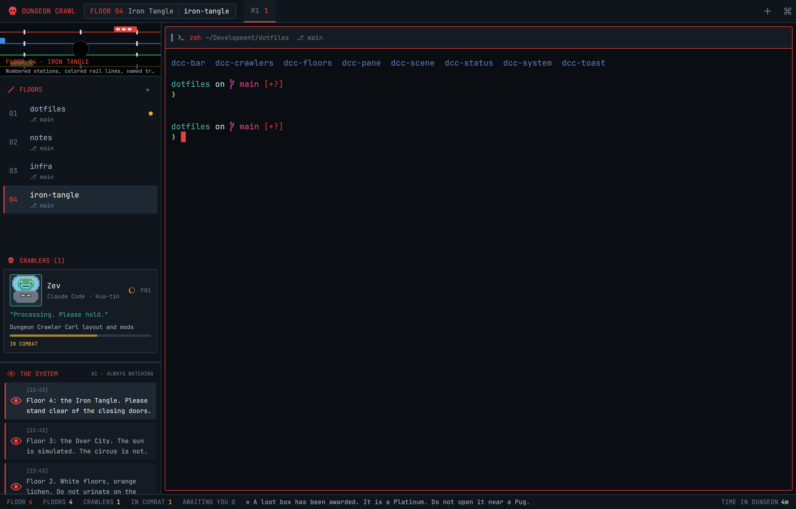

# Dungeon Crawler Carl for Herdr

A complete [Herdr](https://herdr.dev) layout themed on *Dungeon Crawler Carl*: spaces are floors of the World Dungeon (11 of them, each with its own theme and animated scene), agents are crawlers drawn as animated 24×24 pixel portraits (click one to change who it is), and a System AI narrates. See [RECIPE.md](RECIPE.md) for exactly what it looks like and does.



## Add it to your Herdr

**Ask your agent.** Herdr's own instructions cover this: tell your agent to add the layout from `sneakytowelsuit/dotfiles`, folder `herdr-dungeon-crawler`. It reads `RECIPE.md` and the files, copies them into `~/.config/herdr-app`, and checks them.

**Or by hand:**

```sh
git clone https://github.com/sneakytowelsuit/dotfiles
cd dotfiles/herdr-dungeon-crawler
H=~/.config/herdr-app
cp layouts/dungeon.json layouts/dungeon.svg "$H/layouts/"
cp themes/*.json "$H/themes/"          # needed: the floors change the theme
cp -r mods/dcc-* "$H/mods/"
herdr-app do layout.switch --name dungeon
```

Don't overwrite files you already have: if `dungeon`, a `dungeon*` theme or a `dcc-*` mod already exists, rename the new one first. Then `herdr-app check ~/.config/herdr-app/mods/dcc-bar` (and the other `dcc-*` mods) should pass. `ctrl-shift-l` switches layouts; deleting the files removes it.

## NixOS

This repo's NixOS config manages it declaratively: `nixos/modules/home/herdr-layout.nix` links every file in this folder into `~/.config/herdr-app` (the layout, the themes and the mods), one file at a time, so Herdr can still write its own files beside them. Edit here, then `sudo nixos-rebuild switch`.

## Privacy

The "crawlers remaining" bars run `sh`, `ls`, `tail` and `grep` to read token counts from Claude Code's session transcripts under `~/.claude/projects/`. Only the `usage` and `model` fields are matched, no conversation text is read or kept, and nothing is sent anywhere. Agents other than Claude Code get no bar.

## Editing

The mods share four modules that must be copied between mod folders (mods can't import across folders). After editing `floors.js`, `scene.js`, `cast.js` or `avatar.js` in `mods/dcc-crawlers/`, run `./sync-shared.sh`. Sprites are text in `mods/dcc-crawlers/sprites/src/`; `mods/dcc-crawlers/sprites/build.sh` rebuilds the SVGs.

Character and floor looks come from the public [DCC wiki](https://dungeoncrawlercarlwiki.com); the wiki gives few colors, so the palettes are mine. *Dungeon Crawler Carl* is by Matt Dinniman; this is an unofficial fan layout.
