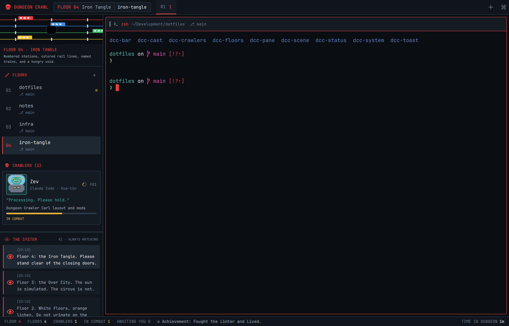

# Dungeon Crawler Carl

A whole Herdr window dressed as the World Dungeon from *Dungeon Crawler Carl*. Every space is a floor of the dungeon and its look changes with the floor: pick floor 4 and the window turns steel-blue with a Red Line accent and trains run through the sidebar banner. Every agent is a crawler from the cast (Carl, Princess Donut, Mordecai, Katia, Mongo, Bautista, Zev, Elle, Quasar, Lucia Mar), drawn as a 24×24 pixel portrait that moves with what the agent is doing, and a System AI narrates what they get up to.

## What you see

Top to bottom, a `column` on a near-black canvas, with the system title bar hidden:

- **Top bar, 40px** (drag to move the window). Left to right: a red skull and "DUNGEON CRAWL" in the accent color (12px, semibold); a bordered chip `FLOOR 04  Iron Tangle | <space name>`; the shown space's tabs as "rooms" (`R1 1`, `R2 2`, ..., the active one has a 2px accent underline and a surface-colored background, others are muted); then a `+` (new tab) and a command-palette button on the right, and window buttons where the system draws none (Linux, Windows).
- **Sidebar, 280px wide** (resizable 190 to 440; a 1px border divides it from the work area). Three stacked blocks:
  1. **Scene banner, 140px.** An 80px animated scene for the shown space's floor, and under it, on the chrome background, `FLOOR 04 · IRON TANGLE` (11px, accent) over the floor's full description (9px, muted, wrapping to as many lines as it needs, never truncated).
  2. **Floors and crawlers** (fills the middle). `FLOORS` header with a `+` (new space), then one row per space: floor number (`01`) in accent when active, space name, git branch, a pulsing status dot. Below, `CRAWLERS (n)` and one card per agent: a framed pixel portrait, the character's name, `<program> · <role>`, a quoted catchphrase in the character's color, the agent's terminal title, a 4px "health bar", and a status label.
  3. **The System, 230px.** An eye icon and `THE SYSTEM` with `AI · ALWAYS WATCHING`, then a scrolling log of timestamped messages, newest first and highlighted, each with the character's portrait (or the eye) and a colored left border.
- **Work area.** The shown tab's panes as cards (1px border, 3px radius, 6px gap, accent border on the focused pane). Each pane has a 38px header: a 3px status bar, the character portrait (agent panes) or the program icon, the name, `<program> · <folder> ⎇ <branch>`, and a status tag; hover shows split right, split down, zoom and close.
- **Status bar, 26px.** `FLOOR n`, `FLOORS n`, `CRAWLERS n`, `IN COMBAT n`, `AWAITING YOU n`, a rotating System quip every 15 seconds, and `TIME IN DUNGEON`.
- **Type:** JetBrains Mono everywhere, 14px terminals, 11 to 13px UI.

### The floors

Eleven floors, each with its own theme file and scene. Accent colors are the floor's own.

| # | Name | Look | Scene (all native loops) |
|---|---|---|---|
| 1 | First Floor | warm concrete, `#f0983a` | grid of sectors, warm refuge doors pulsing, a goblin block, a green slime sliding |
| 2 | Second Floor | pale floors, orange lichen, `#ee7a30` | cinderblock wall, white floor, pulsing orange lichen, glowing vertical shafts |
| 3 | The Over City | deep red, `#ff3a7a` | red simulated sun, skyline, striped big top, flickering `DESPERADO` neon |
| 4 | Iron Tangle | steel and rail red, `#e5413a` | four colored rail lines (red, blue, green, yellow), station ticks, a black void, four trains shuttling |
| 5 | The Bubbles | sand and storm, `#e0b45c` | four quadrants (air, land, sea, underground), drifting sand, lightning flashes |
| 6 | The Hunting Grounds | jungle, `#7fd150` | ruins and thorned vines that grow downward and retract, red thorn dots |
| 7 | The Great Race | glass cyan, `#5de0ff` | three glass tubes with racers, a `3 2 1 GO` countdown, a faint `7` |
| 8 | Ghosts of Earth | spectral teal, `#8fe3d0` | pastel Havana skyline, translucent ghosts walking through it |
| 9 | Faction Wars | mud and water, `#c9924c` | funnel-shaped city, waterfall, flood water rising and falling |
| 10 | Don't Come in Last | asphalt and caution amber, `#ffb000` | hazard-striped garage, seven lanes with racers, a red zone creeping up from the garage |
| 11 | Parade of Horribles | purple and magenta, `#ff4fd8` | bunting, falling confetti, three floats rolling by, a big tree, `T-3:15` |

### The cast

Eight-bit style, 24×24, drawn from the DCC wikis where they describe a look (colors the wikis don't give are choices): Carl (heart boxers, leather jacket), Princess Donut (head with glasses and tiara), Mordecai (Rat Kin side profile), Katia (purple mohawk), Mongo (blue raptor in profile, pink feathers), Bautista (tiger bust), Zev (aquatic, in a water-filled helmet), Elle (blue Frost Maiden), Quasar (gray Nullian, wide striped tie), Lucia Mar (dark hair, her two Rottweilers).

## How it behaves

**An agent is a crawler.** Each agent terminal gets a character from a hash of its address, so it keeps the same one. Its status drives everything:

| Status | Card label | Portrait | Color |
|---|---|---|---|
| `working` | `IN COMBAT` | bobs up and down (420 ms), spinner ring turns | working gold |
| `blocked` | `AWAITS YOUR INPUT` | jitters sideways (150 ms), red `!` blinks, red frame | blocked red |
| `done` | `ACHIEVEMENT UNLOCKED` | hops (650 ms), four gold and white sparkles twinkle | done pink |
| `idle` | `RESTING IN SAFE ROOM` | breathes slowly (2.6 s), `z`, `z z`, `z z Z` cycles above it | idle grey |

The health bar is 62% (working), 28% (blocked), 100% (done), 85% (idle) and pulses while working or blocked. Pane headers show the same portrait at 30px (24px sprite, 1×); cards show it at 56px (48px sprite, 2×). Sprites always draw at whole multiples so pixels stay crisp.

**Floors.** Clicking the floor chip, the number on a sidebar row, or the scene banner opens the floor picker (a 4-column dialog of the 11 floors, each with a live mini scene, the book, and a one-line description). Picking one stores it for that space and the window takes that floor's theme. "Back to default" appears once a floor has been picked. A space with no pick is on floor `min(its position, 11)`. The choice persists in shared state under the key `dcc.floors` (`{ "<space id>": <floor number> }`).

**Characters.** Clicking a portrait (the sidebar card or the pane header) opens the character picker: a 5-column dialog of all ten characters, each portrait playing the animation for the agent's status right now, with the current one marked `CURRENT`. Picking one stores it for that agent in shared state under `dcc.cast` (`{ "<agent address>": "<character name>" }`) and every mod redraws with it; "Back to automatic" returns to the hash-chosen character.

**The whole window follows the floor.** The top bar watches the shown space's floor and, when it changes, runs `app.theme` with `dungeon-f<n>`. Switching spaces switches the look.

**The System.** It logs, in its own voice, when an agent arrives, starts working, becomes blocked, finishes, or leaves, and when the shown space's floor changes. Log keeps 40 messages.

**Clicks.** Tab click selects it; right-click opens the shipped `menu` popup. Space row click selects the space; right-click opens its menu. Agent card click focuses its pane. Floor chip's space-name segment opens the shipped `picker` for quick space switching. Pane header click focuses the pane.

## Built from

`layouts/dungeon.json`, a `column`: `bar` (40px, `window_drag`) → `body` row (`sidebar` column with `scene` 140px, `crawlers`, `system` 230px; then `main` tab block with pane frames and the `dcc-pane` header, 38px) → `status` (26px). Root: `"theme": "dungeon"`, `"titlebar": "none"`, `"toast": "dcc-toast"`, `"ui_font": "JetBrains Mono"`, preview `layouts/dungeon.svg`.

**Themes** (`themes/`): `dungeon.json` (the layout's own, since it is named like the layout) and `dungeon-f1.json` to `dungeon-f11.json`, one per floor. They are full theme files (background, foreground, selection, cursor, 16 ANSI colors, panel `colors`). **Copy them to the home's `themes/`**; without them the floors do not change the look.

**Mods** (`mods/`), each with `mod.json` `{"place": "none"}`:

| Mod | Role |
|---|---|
| `dcc-bar` | top bar; applies the floor theme with `app.theme`; opens `dcc-floors` and the shipped `picker` and `menu` |
| `dcc-scene` | sidebar banner; draws `scene(n)` from `scene.js` |
| `dcc-crawlers` | floors list and agent cards; calls `setAgentOrder`; owns the shared modules below, plus `sprites/` (24×24 SVGs) |
| `dcc-system` | the System AI log |
| `dcc-pane` | pane header |
| `dcc-toast` | notifications as System announcements (`"toast"` in the layout) |
| `dcc-status` | bottom bar |
| `dcc-floors` | the floor picker dialog, props `{ space, overlay }` |
| `dcc-cast` | the character picker dialog, props `{ address, overlay }` |

**Shared modules.** Mods can't import across folders, so these live in `dcc-crawlers/` and are copied: `floors.js` (floor data and `floorOf`, `setFloor`) into `dcc-bar`, `dcc-scene`, `dcc-floors`, `dcc-status`, `dcc-system`; `scene.js` into `dcc-scene`, `dcc-floors`; `cast.js` (cast, `who`, `setCast`, `sprite`) into `dcc-system`, `dcc-pane`, `dcc-cast`; `avatar.js` into `dcc-pane`, `dcc-cast`. `sync-shared.sh` redoes the copies. Edit the originals in `dcc-crawlers/`.

**Sprites.** `mods/dcc-crawlers/sprites/src/<name>.txt` is one palette (`=X #hex`) plus 24 rows of pixels; `=mirror` makes rows the left 12 columns; a leading `|` is a full un-mirrored row. `sprites/build.sh` turns them into the SVGs.

**`herdr` API used:** `spaces`, `agents`, `panes`, `theme`, `window`, `run`, `openOverlay`, `closeOverlay`, `props`, `shared`, `setShared`, `setAgentOrder`. **Commands:** `app.theme`, `app.palette`, `space.select`, `space.new`, `tab.select`, `tab.new`, `pane.focus`, `pane.split`, `pane.zoom`, `pane.close`, `window.minimize`, `window.maximize`, `window.close`. **Shipped mods used:** `menu`, `picker`. Motion is all native (`.loop`, `.frames`, `.spin`); there are no timers except the status bar's two (15 s quip, 60 s clock). No network, no programs run, no files read outside the mods' own folders.

## Watch out

- **Themes are part of the layout.** A fresh install that copies only `layouts/` and `mods/` has no floor themes: `app.theme` then has nothing to apply. Copy `themes/*.json` too.
- **`app.theme` overrides the theme picker.** Each time the shown space's floor changes, the layout sets its theme; a theme chosen by hand lasts until the next switch.
- **Floor number is not the space number once you pick.** Unpicked spaces use their position (so the sixth space is Floor 6); picked ones keep their pick, even if spaces are reordered.
- **Look sources.** Floor settings and character looks come from the public DCC wiki (dungeoncrawlercarlwiki.com). The wiki gives almost no colors, so palettes are interpretation. Floors above 11 are not in the picker.
- **Pixel rows must be exact.** A sprite file with the wrong row length or count draws wrong; `build.sh` prints which row.
- **Limits.** 11 floors, 10 characters. A character comes from a hash of the agent address, so two agents can end up with the same one. The scene banner measures its own width; below about 190px the sidebar is cramped.
- **Character picks are keyed by agent address.** If an address is later reused by a different agent, the pick sticks to it; "Back to automatic" in the picker clears it.
- **Mod copies.** Editing `floors.js`, `scene.js`, `cast.js` or `avatar.js` anywhere but `dcc-crawlers/` is undone by `sync-shared.sh`.
- **Needs** the shipped `menu` and `picker` mods and `herdr-app` with `app.theme`, `openOverlay` and `shared` (the current release).
- **The layout file is read from the home.** `layout.set` and similar tree edits write it; if your setup makes it read-only (Nix, for example), those edits fail. Copy the layout and edit the copy.

## Done when

1. `herdr-app check mods/<name>` passes for all nine mods.
2. `layout.switch {name: "dungeon"}` shows a top bar, a three-part sidebar and a status bar; `herdr-app status` has no errors.
3. With one space, the chip reads `FLOOR 01 First Floor`; creating three more spaces makes the fourth read `FLOOR 04 Iron Tangle`, the window turns steel-blue with a red accent, trains move in the banner, and the System logs `Floor 4: the Iron Tangle. ...`.
4. Clicking the chip opens a picker of 11 floors; choosing floor 7 for the shown space changes the window to glass cyan, the banner to tubes and racers, and the chip to `FLOOR 07 The Great Race`.
5. Clicking an agent's portrait opens the character picker; choosing Carl turns that agent into Carl in its sidebar card, its pane header and the System log, and "Back to automatic" restores it.
6. A working agent shows a bobbing portrait and `IN COMBAT`; a blocked one jitters with a blinking red `!` and `AWAITS YOUR INPUT`.
7. Quitting and reopening keeps each space's floor and each agent's character.
